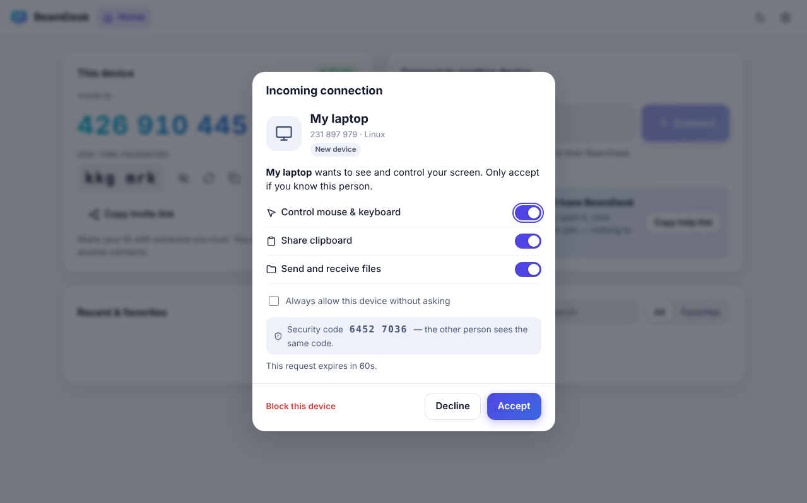
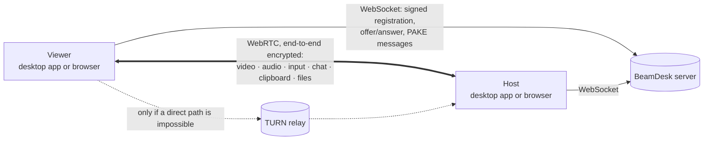

<div align="center">


# BeamDesk

**Free, open-source remote desktop that anyone can use.**
Help family, support customers, or reach your own computers — end-to-end encrypted,
peer-to-peer, self-hostable, with a desktop app **and** a zero-install browser version.

[](https://github.com/Safiullah-Rahu/BeamDesk/actions/workflows/ci.yml)
[](LICENSE)

[Download](https://github.com/Safiullah-Rahu/BeamDesk/releases/latest) ·
[User guide](docs/USER_GUIDE.md) ·
[Host your own server](docs/SELF_HOSTING.md) ·
[Security](docs/SECURITY_MODEL.md) ·
[Security audit](docs/SECURITY_AUDIT.md) ·
[Architecture](docs/ARCHITECTURE.md)


</div>

---

## Why BeamDesk?

- **Two steps to connect.** Read out your 9-digit ID, the other person clicks **Accept**. Or send a link — one click and you are in.
- **No install needed to get help.** Send someone your *help link*: they open it in any modern browser, click *Share my screen*, and you join. Nothing to download, no account.
- **Fast.** Direct peer-to-peer WebRTC, hardware-accelerated video (AV1 / VP9 / H.264, picked automatically), 60 fps, near-zero receive buffering, unordered low-latency mouse channel.
- **Private by design.** Video, input, chat, clipboard and files go device-to-device with DTLS-SRTP encryption. Passwords never leave your device (CPace PAKE). Every device proves its identity with its own Ed25519 key. Your IP is not revealed to anyone until you accept.
- **Yours.** MIT licensed, no accounts, no telemetry. Run your own server with one `docker compose up`.

## Features

| | |
|---|---|
| 🖥️ **Remote control** | Mouse, keyboard (any layout — type text mode, or physical keys for games), scroll, special keys (Win, Alt+Tab, Win+L, Ctrl+Shift+Esc, Cmd+Space…), Cmd ↔ Ctrl translation between Mac and PC |
| 🪟 **Multi-monitor** | Switch displays during a session |
| ⚡ **Quality presets** | Fastest / Balanced / Best quality / Custom (fps, bitrate, resolution), codec choice, live stats (latency, fps, bitrate, codec, route) |
| 📋 **Clipboard sync** | Copy on one side, paste on the other |
| 📁 **File transfer** | Drag & drop both ways, streamed to disk, progress, cancel, delivery receipts |
| 💬 **Chat** | Encrypted text chat in every session |
| 🔊 **Sound** | Hear the remote computer (Windows hosts) |
| 🎬 **Record & screenshot** | Save a session as WebM or a PNG screenshot |
| 🔐 **Access control** | Accept prompt with per-session permissions, one-time password (rotates after each session), unattended access with a permanent password, trusted devices, block list, lock screen when a session ends |
| 🌐 **Browser version** | Control a computer from any browser — including phones and tablets (touch gestures, on-screen keyboard); share your own screen from a browser (view-only) |
| 🛟 **Help links** | Reverse connection: the person who needs help just opens your link |
| 🗂️ **Address book** | Recent devices, favorites, nicknames, online status, saved passwords (encrypted with the OS keychain) |
| 🧭 **Tabs** | Several remote sessions at once; several viewers per host |
| 🛡️ **Visible sessions** | Always-on-top "someone is connected" bar with one-click disconnect, tray status |
| 🌙 **Comfortable** | Light & dark themes, start at login, tray, deep links (`beamdesk://connect/123456789`) |

<p align="center">
  
  
</p>

## Get started (for everyone)

1. **Install BeamDesk** from the [Releases page](https://github.com/Safiullah-Rahu/BeamDesk/releases/latest):
   - **Windows:** `BeamDesk-Setup-…-x64.exe` (one click, no questions) or the portable `.exe` (no install).
   - **macOS:** the `.dmg` for your Mac (`arm64` = Apple silicon, `x64` = Intel).
   - **Linux:** the `.AppImage` (any distro) or `.deb` (Ubuntu/Debian).
   - Or use it **in your browser** at your BeamDesk server's address.
2. **To get help:** tell your helper the **ID** (and one-time password) shown on the left. Click **Accept** when asked.
3. **To help someone:** type their ID on the right and click **Connect** — or send them your **help link**.

The [user guide](docs/USER_GUIDE.md) explains every screen in plain language, with troubleshooting tips.

> BeamDesk needs a small *signaling server* that introduces devices to each other (your screen never passes through it).
> Run your own in minutes — see below. Installers built by this repository's release workflow can have your server address built in, so your users never have to type it.

## Host your own server (5 minutes)

```bash
git clone https://github.com/Safiullah-Rahu/BeamDesk.git
cd BeamDesk/deploy
cp .env.example .env        # set DOMAIN and TURN_SECRET
docker compose up -d        # BeamDesk + automatic HTTPS + TURN relay
```

Open `https://your-domain` — that is the browser version, ready to use. Point the desktop apps at the same address (Settings → Network), or bake it into your own installers.
Other options (Render, Fly.io, a plain Node.js process, private servers with an access key) are in [SELF_HOSTING.md](docs/SELF_HOSTING.md).

**Just want to try it with your phone?** Deploy the free Render test server with one click, or run the server on your computer and open it from your phone on the same Wi‑Fi — step by step in [Try it on your phone](docs/SELF_HOSTING.md#try-it-on-your-phone).

## How it works



1. Each device has an Ed25519 key; its 9-digit ID is derived from the public key.
2. The viewer sends a WebRTC offer to the host's ID through the server.
3. Host and viewer authenticate each other (identity signatures + optional password via CPace), bound to this connection's DTLS fingerprints.
4. The host asks its user to accept (unless a password / trusted device / help link already authorised it).
5. Only then does the host reveal its network addresses; WebRTC connects directly (or via TURN) and the screen starts streaming.

Details: [ARCHITECTURE.md](docs/ARCHITECTURE.md) · [SECURITY_MODEL.md](docs/SECURITY_MODEL.md) · [SECURITY_AUDIT.md](docs/SECURITY_AUDIT.md)

## Repository layout

```
packages/core   Protocol, crypto (identity, CPace), WebRTC host/viewer sessions, file transfer
server          Signaling server (Node.js + ws): registry, relay, TURN credentials, serves the web app
apps/web        The user interface (Preact) — runs in browsers and inside the desktop app
apps/desktop    Electron shell: screen capture, input injection, tray, files, packaging
deploy          Docker Compose (Caddy HTTPS + coturn), Fly.io config
e2e             Playwright end-to-end tests (browser↔browser and desktop host)
docs            Guides
```

## Develop

```bash
npm install
npm run dev            # builds the UI and starts the server on http://localhost:8080
npm run dev:desktop    # in another terminal: the desktop app (uses BEAMDESK_SERVER_URL or Settings)
npm run check          # typecheck + unit tests
npm run test:e2e       # end-to-end tests (Playwright)
```

See [DEVELOPMENT.md](docs/DEVELOPMENT.md) for the full workflow, and [CONTRIBUTING.md](CONTRIBUTING.md) to get involved.

## Platform support

| Platform | Host (share & be controlled) | Viewer (control others) |
|---|---|---|
| Windows 10/11 (x64, ARM64) | ✅ full, incl. sound | ✅ |
| macOS 12+ (Apple silicon, Intel) | ✅ (grant Screen Recording + Accessibility) | ✅ |
| Linux X11 | ✅ | ✅ |
| Linux Wayland | 👁️ view-only (input injection needs X11) | ✅ |
| Chrome / Edge / Firefox / Safari (desktop) | 👁️ view-only screen sharing | ✅ |
| Phone & tablet browsers | — | ✅ (touch gestures, on-screen keyboard) |

## License

[MIT](LICENSE) — free for personal and commercial use.
