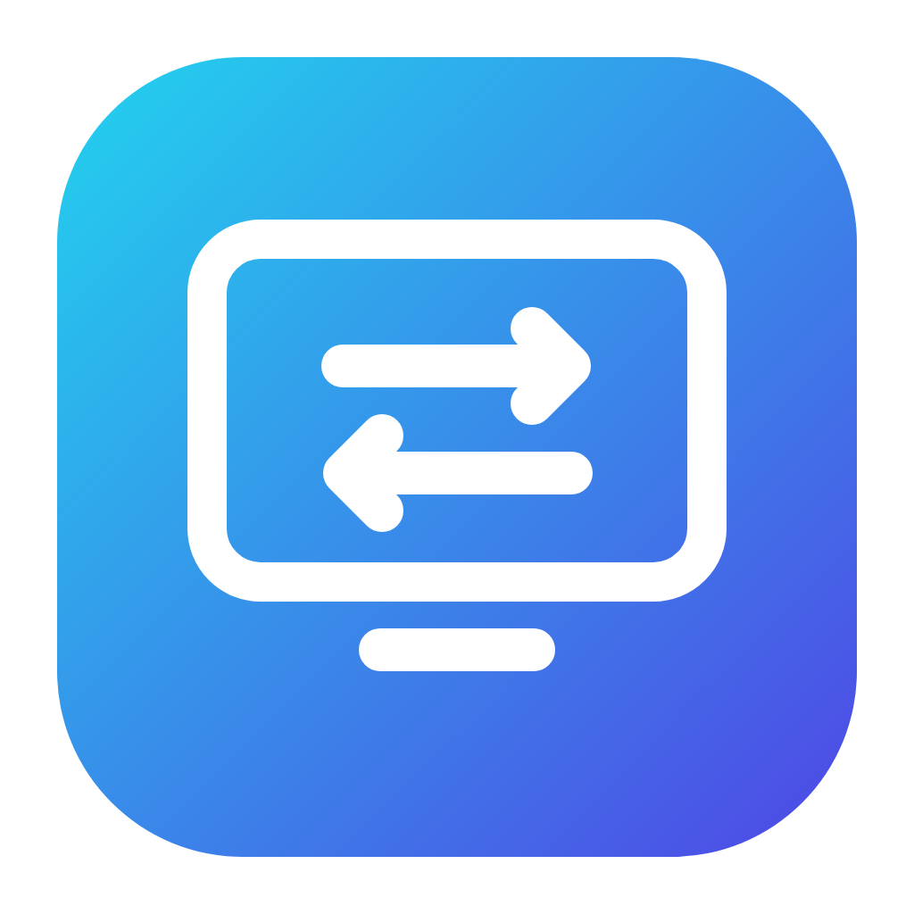
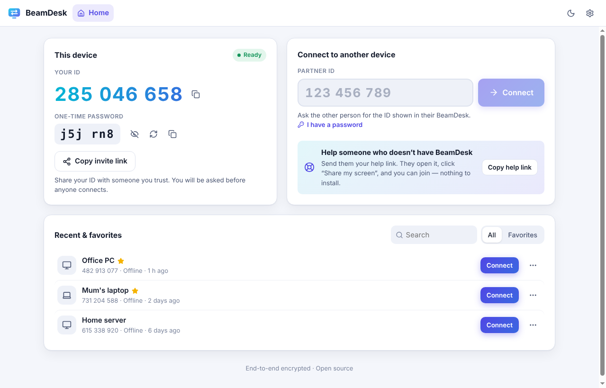
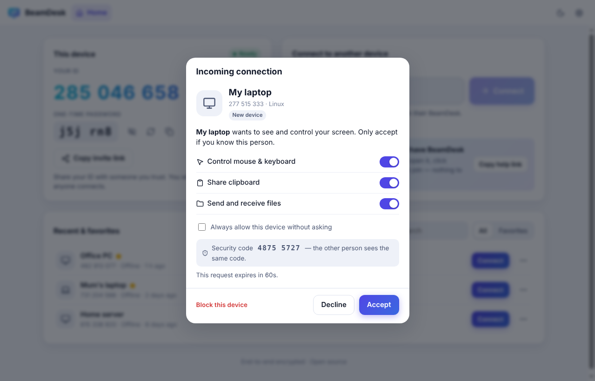
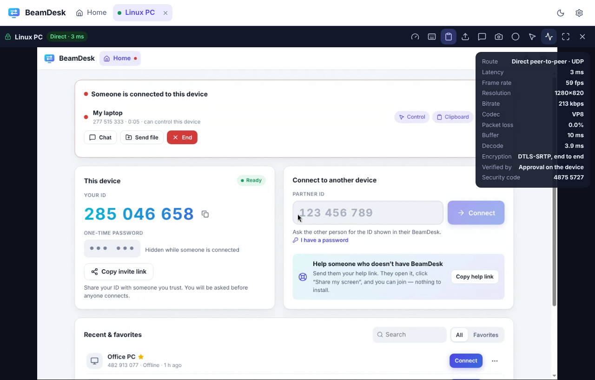
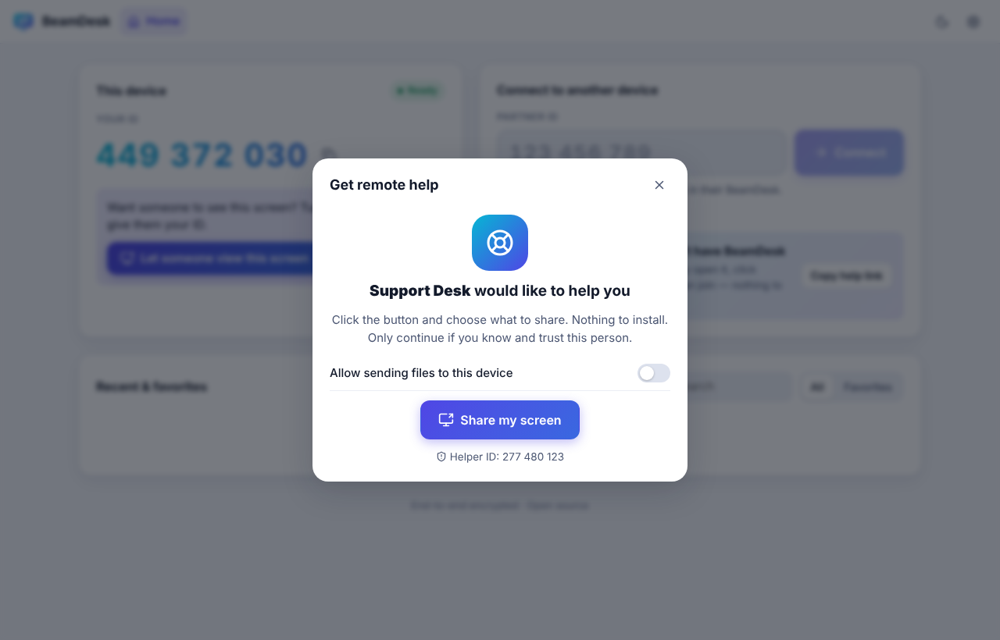
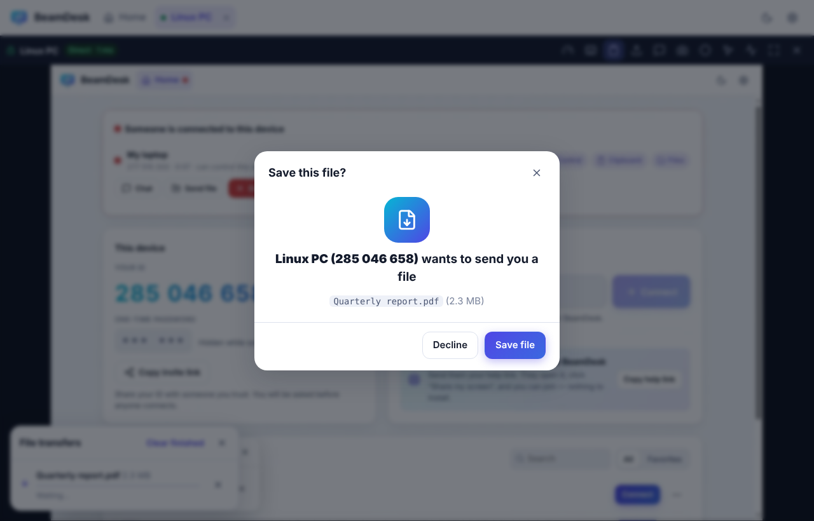
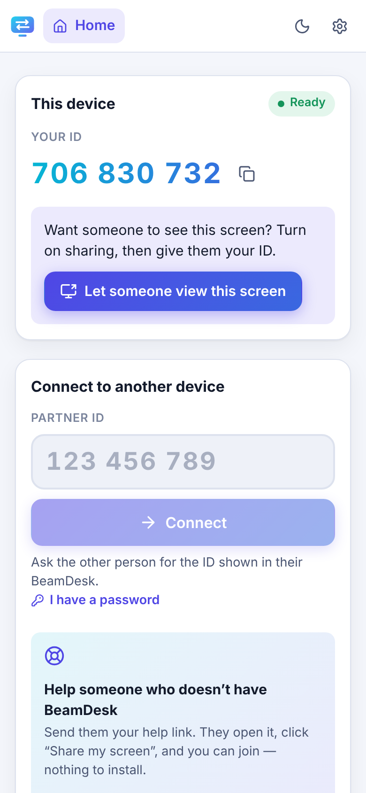
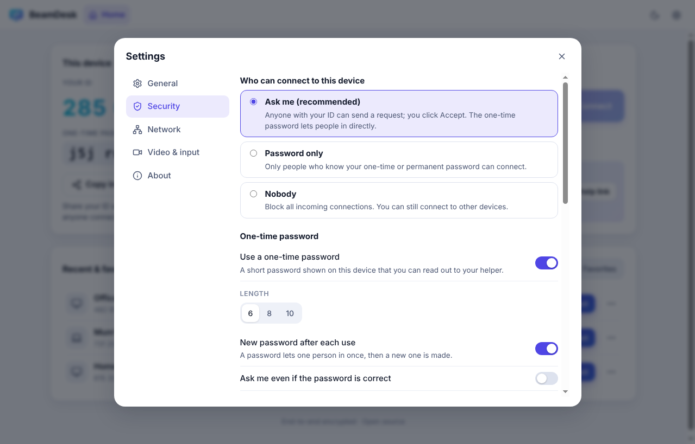
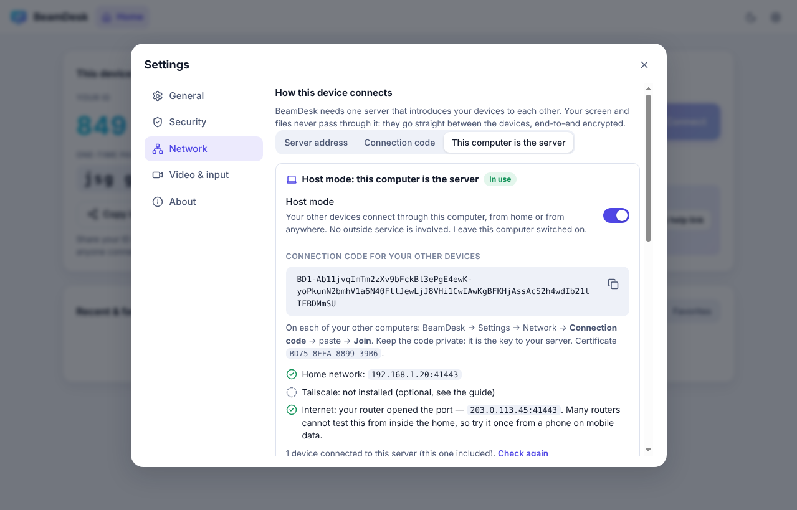
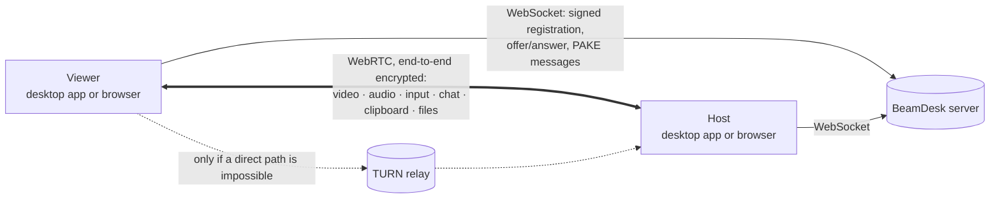

<div align="center">



# BeamDesk

**Free, open-source remote desktop that anyone can use.**
Help family, support customers, or reach your own computers — end-to-end encrypted,
peer-to-peer, self-hostable (even on your own PC), with a desktop app **and** a zero-install browser version.

[](https://github.com/Safiullah-Rahu/BeamDesk/releases/latest)
[](https://github.com/Safiullah-Rahu/BeamDesk/actions/workflows/ci.yml)
[](LICENSE)

[Download](https://github.com/Safiullah-Rahu/BeamDesk/releases/latest) ·
[User guide](docs/USER_GUIDE.md) ·
[Host your own server](docs/SELF_HOSTING.md) ·
[Security](docs/SECURITY_MODEL.md) ·
[Security audit](docs/SECURITY_AUDIT.md) ·
[Architecture](docs/ARCHITECTURE.md)

<picture>
  <source media="(prefers-color-scheme: dark)" srcset="docs/images/home-dark.png" />
  
</picture>

</div>

---

## Download

| Your computer | File on the [Releases page](https://github.com/Safiullah-Rahu/BeamDesk/releases/latest) |
|---|---|
| **Windows 10/11** | `BeamDesk-Setup-<version>-x64.exe` — installs and opens with one click (`-arm64` for ARM PCs). Or `BeamDesk-<version>-portable.exe` to run without installing. |
| **macOS 12+** | `BeamDesk-<version>-mac-arm64.dmg` for Apple silicon (M1–M4), `-mac-x64.dmg` for Intel Macs. |
| **Linux** | `BeamDesk-<version>-linux-x86_64.AppImage` (any distribution) or `-linux-amd64.deb` (Ubuntu, Debian). |
| **No install** | Open your BeamDesk server's address in Chrome, Edge, Firefox or Safari — on a computer, phone or tablet. |

The installers are not code-signed yet: Windows shows *"Windows protected your PC"* (click **More info → Run anyway**) and macOS asks you to right-click BeamDesk → **Open** the first time. Every release lists the SHA-256 checksum of each file in `SHA256SUMS.txt`.

## Why BeamDesk?

- **Two steps to connect.** Read out your 9-digit ID, the other person clicks **Accept**. Or send a link — one click and you are in.
- **No install needed to get help.** Send someone your *help link*: they open it in any modern browser, click *Share my screen*, and you join. Nothing to download, no account.
- **Fast.** Direct peer-to-peer WebRTC, hardware-accelerated video (AV1 / VP9 / H.264, picked automatically), 60 fps, near-zero receive buffering, unordered low-latency mouse channel.
- **Private by design.** Video, input, chat, clipboard and files go device-to-device with DTLS-SRTP encryption. Passwords never leave your device (CPace PAKE). Every device proves its identity with its own Ed25519 key. Your IP address is not revealed until you accept.
- **Audited.** A full [security audit](docs/SECURITY_AUDIT.md) fixed 32 issues before the first release, and every attack it found is now an automated test.
- **No server needed.** Turn on **host mode** on a computer that stays on and it *is* your BeamDesk server — with a built-in relay, automatic router setup and a pinned certificate. No accounts, no cloud, no third parties.
- **Yours.** MIT licensed, no accounts, no telemetry. Or run a server with one `docker compose up`, or for free on Render.

## Features

| | |
|---|---|
| 🖥️ **Remote control** | Mouse, keyboard (any layout — type text mode, or physical keys for games), scroll, special keys (Win, Alt+Tab, Win+L, Ctrl+Shift+Esc, Cmd+Space…), Cmd ↔ Ctrl translation between Mac and PC |
| 🪟 **Multi-monitor** | Switch displays during a session |
| ⚡ **Quality presets** | Fastest / Balanced / Best quality / Custom (fps, bitrate, resolution), codec choice, live stats (latency, fps, bitrate, codec, route) |
| 📋 **Clipboard sync** | Copy on one side, paste on the other — applied only while you are looking at the session |
| 📁 **File transfer** | Drag & drop both ways, streamed to disk, progress, cancel, delivery receipts. Nothing is saved without your OK; programs and scripts are flagged |
| 💬 **Chat** | Encrypted text chat in every session |
| 🔊 **Sound** | Hear the remote computer (Windows hosts) |
| 🎬 **Record & screenshot** | Save a session as WebM or a PNG screenshot |
| 🔐 **Access control** | Accept prompt with per-session permissions, one-time password (works once, hidden while someone is connected), unattended access with a permanent password, trusted devices, block list, lock screen when a session ends |
| 🌐 **Browser version** | Control a computer from any browser — including phones and tablets (touch gestures, on-screen keyboard); share your own screen from a browser (view-only) |
| 🛟 **Help links** | Reverse connection: the person who needs help just opens your link |
| 🗂️ **Address book** | Recent devices, favorites, nicknames, online status, saved passwords (encrypted with the OS keychain) |
| 🧭 **Tabs** | Several remote sessions at once; several viewers per host |
| 🛡️ **Visible sessions** | Always-on-top "someone is connected" bar with one-click disconnect, tray status |
| 🏠 **Host mode** | One computer is the server: HTTPS/WSS with a pinned self-signed certificate, built-in STUN/TURN relay, router port opening (UPnP / NAT-PMP), Tailscale detection, a connection code for your other devices, back on by itself after a restart |
| 🌙 **Comfortable** | Light & dark themes, start at login, tray, deep links (`beamdesk://connect/123456789`) |

<p align="center">
  <picture>
    <source media="(prefers-color-scheme: dark)" srcset="docs/images/incoming-request-dark.png" />
    
  </picture>
  <picture>
    <source media="(prefers-color-scheme: dark)" srcset="docs/images/remote-session-dark.png" />
    
  </picture>
  <picture>
    <source media="(prefers-color-scheme: dark)" srcset="docs/images/help-link-dark.png" />
    
  </picture>
  <picture>
    <source media="(prefers-color-scheme: dark)" srcset="docs/images/file-consent-dark.png" />
    
  </picture>
</p>

<p align="center">
  <picture>
    <source media="(prefers-color-scheme: dark)" srcset="docs/images/mobile-dark.png" />
    
  </picture>
  &nbsp;&nbsp;
  <picture>
    <source media="(prefers-color-scheme: dark)" srcset="docs/images/settings-security-dark.png" />
    
  </picture>
</p>

## Get started (for everyone)

1. **Install BeamDesk** (see [Download](#download)), or open your BeamDesk server's address in a browser.
2. **To get help:** tell your helper the **ID** (and one-time password) shown on the left. Click **Accept** when asked.
3. **To help someone:** type their ID on the right and click **Connect** — or send them your **help link**.

The [user guide](docs/USER_GUIDE.md) explains every screen in plain language, with troubleshooting tips.

> BeamDesk needs a small *signaling server* that introduces devices to each other (your screen never passes through it).
> Let one of your computers be that server (host mode), or run one in minutes — see below. Installers built by this repository's release workflow can have your server address built in, so your users never have to type it.

## Use one of your computers as the server (host mode)

On a computer that stays on: **Settings → Network → This computer is the server → Host mode**. BeamDesk starts its own server and relay on that computer, asks your router to open the port, and shows a **connection code**. On your other computers: **Settings → Network → Connection code** → paste → **Join**. Phones and browsers get a link.

<p align="center">
  <picture>
    <source media="(prefers-color-scheme: dark)" srcset="docs/images/settings-hostmode-dark.png" />
    
  </picture>
</p>

- Works at home right away; from anywhere through your router (opened automatically when it allows it), or through [Tailscale](https://tailscale.com) where port forwarding is impossible.
- Survives restarts: BeamDesk starts at sign-in, keeps the computer awake while hosting and turns host mode back on with the same code. Switch it off in Settings or from the tray icon.
- Secure by default: TLS 1.3 with a certificate pinned by the code, a 128-bit access key, a relay that only connects your own devices with each other, nothing exposed but one port. Details in the [security model](docs/SECURITY_MODEL.md#host-mode-a-computer-is-the-server).

Step by step: [user guide](docs/USER_GUIDE.md#make-one-of-your-computers-the-server-host-mode).

## Host your own server (5 minutes)

```bash
git clone https://github.com/Safiullah-Rahu/BeamDesk.git
cd BeamDesk/deploy
cp .env.example .env        # set DOMAIN, and TURN_SECRET=$(openssl rand -hex 32)
docker compose up -d        # BeamDesk + automatic HTTPS + TURN relay
```

Open `https://your-domain` — that is the browser version, ready to use. Point the desktop apps at the same address (Settings → Network), or bake it into your own installers.
Other options (Render, Fly.io, a plain Node.js process, private servers with an access key) are in [SELF_HOSTING.md](docs/SELF_HOSTING.md).

**Just want to try it with your phone?** Deploy the free Render test server with one click, or run the server on your computer and open it from your phone on the same Wi‑Fi — step by step in [Try it on your phone](docs/SELF_HOSTING.md#try-it-on-your-phone).

## Security

- **End to end:** screen, input, chat, clipboard and files are encrypted between the two devices (DTLS-SRTP / DTLS). The server only introduces devices; it never sees content or passwords.
- **Identity:** every device has its own Ed25519 key, its ID is derived from it, and both sides sign the handshake. Invite and help links pin the exact device's key.
- **You decide:** nothing connects without your accept, a password that works once, or a device you trusted. Your IP address stays private until you accept, and every session is visible with one-click disconnect.
- **Home servers are pinned:** in host mode the connection code carries the server certificate's fingerprint and an access key; the app talks to no other server, and the built-in relay cannot reach anything but your own devices.
- **Tested like an attacker:** the test suite includes a tampering relay that tries to swap certificates, forge acceptances, strip the password step, hang up sessions and send fake "support" invites — every attempt must fail.

Read the [security model](docs/SECURITY_MODEL.md) and the [audit report](docs/SECURITY_AUDIT.md). Found a problem? See [SECURITY.md](SECURITY.md).

## How it works



1. Each device has an Ed25519 key; its 9-digit ID is derived from the public key.
2. The viewer sends a WebRTC offer to the host's ID through the server.
3. Host and viewer authenticate each other (identity signatures + optional password via CPace), bound to this connection's DTLS fingerprints.
4. The host asks its user to accept (unless a password / trusted device / help link already authorised it).
5. Only then does the host reveal its network addresses; WebRTC connects directly (or via TURN) and the screen starts streaming.

Details: [ARCHITECTURE.md](docs/ARCHITECTURE.md) · [SECURITY_MODEL.md](docs/SECURITY_MODEL.md) · [SECURITY_AUDIT.md](docs/SECURITY_AUDIT.md)

## Repository layout

```
packages/core   Protocol, crypto (identity, CPace), WebRTC host/viewer sessions, file transfer
server          Signaling server (Node.js + ws): registry, relay, TURN credentials, serves the web app;
                host mode: TLS, built-in STUN/TURN, UPnP/NAT-PMP, connection codes
apps/web        The user interface (Preact) — runs in browsers and inside the desktop app
apps/desktop    Electron shell: screen capture, input injection, tray, files, packaging
deploy          Docker Compose (Caddy HTTPS + coturn), Fly.io config
e2e             Playwright end-to-end tests: browser↔browser, desktop host, attacks via a tampering relay
docs            Guides, security model and audit, screenshots
```

## Develop

```bash
npm install
npm run dev            # builds the UI and starts the server on http://localhost:8080
npm run dev:desktop    # in another terminal: the desktop app (uses BEAMDESK_SERVER_URL or Settings)
npm run check          # typecheck + unit tests
npm run test:e2e       # end-to-end tests (Playwright)
```

See [DEVELOPMENT.md](docs/DEVELOPMENT.md) for the full workflow (including releasing and regenerating the screenshots), and [CONTRIBUTING.md](CONTRIBUTING.md) to get involved.

## Platform support

| Platform | Host (share & be controlled) | Viewer (control others) |
|---|---|---|
| Windows 10/11 (x64, ARM64) | ✅ full, incl. sound | ✅ |
| macOS 12+ (Apple silicon, Intel) | ✅ (grant Screen Recording + Accessibility) | ✅ |
| Linux X11 | ✅ | ✅ |
| Linux Wayland | 👁️ view-only (input injection needs X11) | ✅ |
| Chrome / Edge / Firefox / Safari (desktop) | 👁️ view-only screen sharing | ✅ |
| Phone & tablet browsers | — | ✅ (touch gestures, on-screen keyboard) |

## License

[MIT](LICENSE) — free for personal and commercial use.
