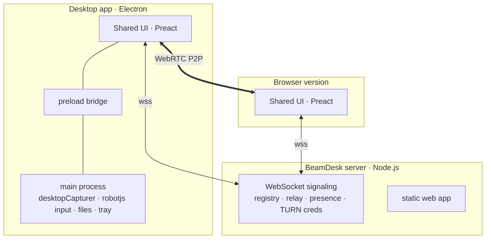

# Architecture

## Components

| Path | What it is |
|---|---|
| `packages/core` | Platform-neutral TypeScript: wire protocol, identity, CPace, SDP helpers, signaling client, `ViewerSession`, `HostService`/`HostSession`, file transfer, key mapping, stats. Runs in browsers, Electron and Node (tests). |
| `server` | `ws`-based signaling server. Bundled with esbuild into one `server.mjs`. Also serves the built web app from memory with precompressed brotli/gzip and strict security headers. |
| `apps/web` | The user interface (Preact + @preact/signals). A platform layer (`src/platform`) abstracts browser vs desktop. |
| `apps/desktop` | Electron main process + sandboxed preload. Loads the web UI from a privileged `app://beamdesk` origin. In host mode it runs the server (`server/src/hostmode.ts`) in the main process and opens pinned WebSockets to home servers for the UI (`src/pinnedsocket.ts`). |
| `server/src/hostmode.ts` | Host mode: the signaling server over TLS 1.3 with a self-signed certificate (`cert.ts`), the built-in STUN/TURN relay (`turn.ts`), router port mapping (`portmap.ts`, UPnP IGD + NAT-PMP), address discovery (`netinfo.ts`) and the connection code (`packages/core/src/joincode.ts`). |

## Signaling protocol

JSON over WebSocket at `/ws` (see `packages/core/src/protocol.ts`).

| Direction | Message | Meaning |
|---|---|---|
| S→C | `hello {challenge, server}` | Sent on connect |
| C→S | `register {pk, sig, name, platform, version, key?}` | Signature over the challenge |
| S→C | `registered {id, ice}` | ID derived from `pk`; ICE servers incl. TURN credentials |
| C→S | `signal {to, sid, kind, data}` | Relayed to `to` as `signal {from, sid, kind, data}` |
| S→C | `undeliverable {to, sid, reason}` | Target offline / rate limited |
| C→S | `presence {ids, rid}` / `ice {rid}` | Address-book online status / fresh TURN credentials |
| S→C | `replaced` | The same identity connected from another window |

Signal kinds: `offer`, `answer`, `auth`, `pending`, `auth-result`, `ice`, `bye`, `invite`.

## Session lifecycle

1. **Offer.** The viewer creates an `RTCPeerConnection` with three pre-negotiated data channels and two receive-only transceivers (video, audio), and sends the offer.
2. **Answer + hello.** The host applies the offer (adding `x-google-start-bitrate` hints so quality ramps quickly), turns the transceivers to `sendonly`, orders codecs (hardware-accelerated first, detected via `MediaCapabilities.encodingInfo({type:'webrtc'})`), and answers with its signed hello and CPace shares.
3. **Auth.** The viewer verifies the host, answers with its signature, CPace shares and confirmation tags.
4. **Decision.** Permanent password → accept. One-time password → accept (unless "ask even with password"). Help-link pre-approval or trusted device → accept. Otherwise → `pending`, prompt the user (60 s timeout).
5. **Connect.** The host releases its ICE candidates, starts capture and `replaceTrack`s the screen into the already negotiated transceiver — no renegotiation needed. Switching monitors is another `replaceTrack`.
6. **Recover.** The viewer restarts ICE on `failed`/`disconnected` (network change) or if the transport is not up 8 s after acceptance; the host answers restarts in place.
7. **End.** `bye` on the control channel and through the server; the host releases all held keys/buttons, rotates the one-time password if it was used, optionally locks the screen.

## Data channels

| Channel | Options | Content |
|---|---|---|
| `ctl` (id 0) | ordered, reliable | JSON control messages: buttons, wheel, keys, text, combos, display selection, quality, permissions, chat, clipboard |
| `ptr` (id 1) | unordered, `maxRetransmits: 0` | 7-byte binary pointer moves `[type][seq u16][x u16][y u16]`; stale packets dropped by sequence number |
| `file` (id 2) | ordered, reliable | File transfer: JSON `start/end/ack/cancel/reject` + binary chunks `[id u32][≤64 KB]`, back-pressure via `bufferedAmount` |

Pointer coordinates are normalised to `0..1` of the shared display, so resolution and DPI differences never matter; the desktop host maps them to physical pixels per display (`screen.dipToScreenPoint` on Windows/Linux, points on macOS).

## Performance choices

- **Peer-to-peer first** (STUN), TURN only as fallback; `bundlePolicy: max-bundle`, small ICE candidate pool for faster setup.
- **Hardware encoders first**: AV1 → VP9 → H.264 if power-efficient, else H.264 → VP8 → VP9 in software.
- **Quality presets** map to `maxBitrate`, `maxFramerate`, `scaleResolutionDownBy`, `degradationPreference` and the track `contentHint` (`motion`/`detail`/`text`).
- **Low latency playback**: `jitterBufferTarget = 0` / `playoutDelayHint = 0` on receivers.
- **Input path**: coalesced pointer events, an unordered channel for moves, zero robotjs delays, text typed as Unicode in "translate" mode.
- **Background-safe**: Electron disables renderer backgrounding so hosting continues with the window hidden; a power-save blocker keeps the display awake during sessions.
- **Tiny footprint**: the UI is ~75 KB gzipped; the server is a single ~200 KB file.

## Keyboard handling

Two modes (`packages/core/src/keymap.ts`):

- **Translate (default):** printable characters are typed as text on the host, independent of either keyboard layout. Shortcuts (Ctrl/Alt/Cmd + key) and special keys are sent as physical keys. Held modifiers are released while typing text so `Shift` never doubles up. AltGr characters are treated as text.
- **Physical:** every key down/up is sent by `KeyboardEvent.code` (good for games).

Cmd ↔ Ctrl are swapped when a Mac controls Windows/Linux and vice versa (configurable).
