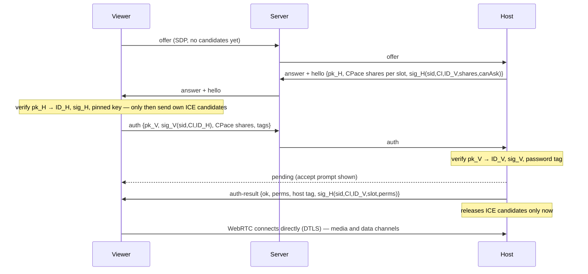

# BeamDesk security model

This document describes what BeamDesk protects against, how, and its known limitations.
To report a vulnerability, see [SECURITY.md](../SECURITY.md).

## Goals

1. Nobody except the two devices in a session can see the screen, input, chat, clipboard or files — not the signaling server, not the TURN relay, not the network.
2. Nobody can connect to a device without the consent of its user: an accept click, a password, a trusted-device decision or a help link the user opened.
3. A malicious or compromised signaling server cannot read sessions, cannot learn passwords, and cannot silently impersonate a device the user has connected to before.
4. Strangers who only know an ID learn as little as possible (in particular, not the host's IP address) until the host accepts.

## Building blocks

| Mechanism | Purpose |
|---|---|
| **WebRTC DTLS-SRTP / SCTP-over-DTLS** | Encryption and integrity of all media and data channels, end to end. |
| **Device identity (Ed25519)** | Each device generates a key pair locally. Its 9-digit ID is derived from the public key: `ID = SHA-256("BeamDesk-ID-v1" ‖ pk)[0..8] mod 9·10⁸ + 10⁸`. Private keys never leave the device (desktop: encrypted with the OS keychain via Electron `safeStorage`). |
| **Signed registration** | The server sends a random challenge; the device signs it. The server verifies the signature and that the ID matches the key, and remembers the first key seen per ID (trust on first use), so an ID cannot be taken over. |
| **Signed handshakes** | Host and viewer sign `sid ‖ channel-id ‖ peer-ID` with their identity keys. Each side checks that the key hashes to the ID it expects. |
| **Channel binding** | `channel-id` = the sorted pair of DTLS certificate fingerprints from the SDP offer and answer. A man-in-the-middle that terminates DTLS on both sides necessarily presents different fingerprints to each side, so signatures and PAKE confirmations fail. |
| **CPace PAKE (ristretto255)** | Password authentication without ever sending the password, not even hashed. Offline dictionary attacks against observed traffic are impossible; every guess needs a live attempt. Run in parallel for the one-time password slot and the permanent password slot. Mutual: the host proves knowledge of the password too. |
| **Trust on first use (viewer side)** | After the first successful session the viewer pins the host's public key. A changed key aborts the connection with a clear warning. |
| **Candidate gating** | The host holds back its ICE candidates and does not run connectivity checks until the request is accepted, so unapproved viewers never learn its IP addresses. Candidates a viewer inlines in its SDP are stripped and gated the same way. Before acceptance a session has no permissions at all (no files, no input). |
| **Signed acceptance** | The host signs `sid ‖ channel-id ‖ viewer-ID ‖ slot ‖ permissions` when it accepts; the viewer ignores acceptances that are unsigned, out of order, or not from the verified host. |
| **Pinned certificates on ICE restart** | Network-change recovery (ICE restarts) is accepted only if the peer's DTLS certificate is unchanged, so nobody can splice another endpoint into a running session. |
| **Key-bound links** | Invite and help links carry a 128-bit hash of the sender's public key. A help link pre-approves exactly that key (not just the 9-digit ID); an invite link makes the viewer refuse any other key. Links never connect on their own: the app asks first. |
| **Rate limits** | Host: 5 wrong passwords within 10 minutes lock password login for 5 minutes; declined viewers are ignored for 30 s; one pending request per viewer and at most 6 pending overall (only accepted sessions count toward the session limit). Server: per-connection message rate, per-device connection-request rate, per-IP connection limit, per-IP limit on registering new device IDs. |

### Password derivation

- One-time password (default 6 characters from a 31-character alphabet without look-alikes, ≈ 2³⁰): `PRS = SHA-256(lv("BeamDesk-PRS-otp-v1", hostID, normalised password))`. Spent as soon as it lets someone in: a new one is generated when the session starts (configurable), and it is hidden while a session is active.
- Permanent password: `PRS = PBKDF2-SHA256(password, "BeamDesk-PRS-perm-v1|" + hostID, 210 000 iterations)`. The host stores only the PRS (encrypted with the OS keychain), never the password.

### CPace instance

```
G   = hash_to_ristretto255(lv(DSI, PRS, CI, sid, slot))        RFC 9380, DST "BeamDesk-CPace-v1_..."
Ya  = ya·G (viewer), Yb = yb·G (host)                          fresh random scalars
K   = ya·Yb = yb·Ya                                            identity element rejected
ISK = SHA-512(lv(DSI_ISK, sid, slot, K, Ya, Yb))
tag_role = HMAC-SHA256(ISK, lv("BeamDesk-confirm-v1", role, sid, CI))
```

### Handshake



## What the server can see

- Device IDs, public keys, device names and platform labels, IP addresses of connected devices, who requests a connection to whom and when, SDP blobs (codecs, DTLS fingerprints; ICE candidates once a host accepted).
- It cannot see screen content, input, chat, clipboard or files, and cannot learn passwords.

The TURN relay (if used) sees encrypted packets and the two endpoints' addresses.

The signature covers the password offer, so a relay cannot remove it to turn a password login
into a plain accept prompt. A viewer that gave a password for a device whose key it has not
verified before (no pin, no link) also requires the host's confirmation tag; without it the
connection stops. Once the data channels are open, only messages on them can end a session —
signaling `bye`/`pending` injected by the server are ignored.

## Hardening in the apps

- Electron: `contextIsolation`, `sandbox`, no Node.js in the page, a minimal preload bridge, IPC accepted only from the app's own origin, navigation and new windows blocked, permissions granted only to the app origin, strict Content Security Policy.
- All data-channel messages are schema-validated and normalised (clamped quality values, boolean-only permissions); key names injected on the host are allow-listed (own properties only).
- Files: nothing is streamed before the receiver accepts. Viewers confirm every file; hosts confirm programs, scripts, installers and shortcuts, which are flagged. At most four incoming files at once. Names are sanitised (no paths, reserved names, bidi tricks or whitespace padding), written as `.part` until complete, bounded by the announced size, and marked as downloaded from the internet (Windows `Zone.Identifier`, macOS quarantine). Shortcut/link files are refused on the desktop.
- One-time passwords are spent when they let someone in and are hidden while a session is active. Wrong passwords lock out the guessing device (5 per 10 minutes); a global budget stops distributed guessing without locking out trusted devices. Each device may trigger at most three accept prompts per 10 minutes.
- Help links contain a random token: only invites that echo it are shown, so nobody can pose as "support" by sending invites to an ID.
- Electron fuses disable running the app as Node.js, `NODE_OPTIONS` and inspector flags, and enforce asar integrity; the main process injects input only while a session with control permission is active, and the download folder can only be set through the folder picker.
- Device names are stripped of control and bidirectional-override characters to prevent spoofed prompts.
- Dialogs never auto-focus a button, so a stray Enter cannot accept an incoming connection.
- The viewer sends its clipboard only while its window is focused, and applies the remote clipboard only while the user looks at that session. Notices from the other device are labelled with its name; unknown close reasons are never shown verbatim.
- If a server already knows a device's ID with a different key, the app generates a new identity instead of failing.
- A visible "someone is connected" bar (excluded from screen capture on Windows/macOS) and tray status show active sessions; ending is always one click away.
- Secrets in the browser version live in `localStorage` of your BeamDesk origin, protected by a strict CSP.

## Limitations

- **A first connection by typed ID (no password, no link) trusts the server for the ID→key mapping.** Hosts sign the handshake and viewers pin keys, so a server cannot impersonate a device you have connected to before. For the *first* connection typed by hand, an attacker controlling the server could try to substitute a device whose key hashes to the same 9-digit ID; with 30 bits that costs about 2³⁰ key generations per targeted ID. Invite and help links (128-bit key hash), the one-time password (CPace) or comparing the **security code** (shown on both sides) remove this risk.
- The security code is derived from the DTLS fingerprints (8 digits). It defeats a real-time interception unless the attacker can find a matching fingerprint pair within the connection setup time.
- Browser hosts are view-only and cannot exclude the reminder bar from capture.
- Linux Wayland sessions can be shared but not remotely controlled (X11 input injection).
- Windows ignores a synthesised Ctrl+Alt+Del (it is a secure attention sequence reserved for the OS), so the Windows security screen cannot be opened remotely. Use the *Win + L* / *Ctrl + Shift + Esc* entries of the keyboard menu instead.
- Unsigned builds trigger OS warnings; configure code signing in the release workflow for production distribution.
