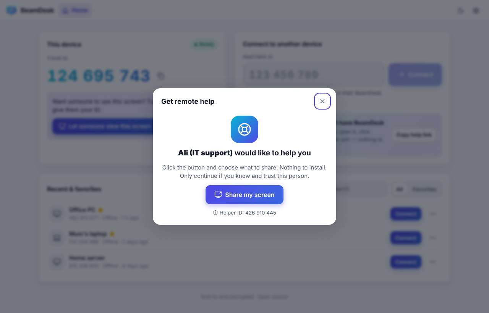
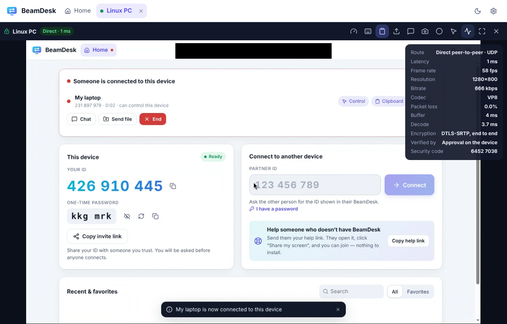

# BeamDesk user guide

This guide is for everyone — no technical knowledge needed.

- [The two halves of the screen](#the-two-halves-of-the-screen)
- [Get help from someone](#get-help-from-someone)
- [Help someone else](#help-someone-else)
- [Help someone who does not have BeamDesk (help link)](#help-someone-who-does-not-have-beamdesk-help-link)
- [During a session](#during-a-session)
- [Reach your own computer any time (unattended access)](#reach-your-own-computer-any-time-unattended-access)
- [Using BeamDesk on a phone or tablet](#using-beamdesk-on-a-phone-or-tablet)
- [Staying safe](#staying-safe)
- [Troubleshooting](#troubleshooting)

---

## Installing

| Your computer | Download | Then |
|---|---|---|
| **Windows** | `BeamDesk-Setup-…-x64.exe` | Double-click it. BeamDesk installs and opens by itself. |
| | `BeamDesk-…-portable.exe` | Runs without installing — handy for a one-off session. |
| **Mac** | `BeamDesk-…-mac-arm64.dmg` (Apple silicon: M1/M2/M3/M4) or `…-mac-x64.dmg` (Intel) | Open it and drag BeamDesk into Applications. |
| **Linux** | `BeamDesk-…-linux-x86_64.AppImage` or `.deb` | AppImage: right-click → Properties → allow executing, then double-click. |

Downloads are on the [Releases page](https://github.com/Safiullah-Rahu/BeamDesk/releases/latest).
You can also skip installing entirely and use BeamDesk **in your web browser** at your BeamDesk server's address.

> **"Windows protected your PC" / "can't be opened because it is from an unidentified developer"?**
> This appears for free apps that are not code-signed. On Windows click **More info → Run anyway**.
> On a Mac, right-click BeamDesk in Applications → **Open** → **Open**. You only need to do this once.

**On a Mac**, BeamDesk will ask for two permissions the first time. Both are needed for someone to help you:

1. **Screen Recording** — so the other person can see your screen.
2. **Accessibility** — so they can move your mouse and type.

BeamDesk shows a yellow banner with an **Open Settings** button for each. Switch BeamDesk **on** in the list that opens, then restart BeamDesk.

---

## The two halves of the screen

- **Left — This device.** Your **ID** (9 digits) and, on the desktop app, a **one-time password**. Give these to someone you trust so they can connect to *you*.
- **Right — Connect to another device.** Type someone else's ID here to connect to *them*.
- **Below — Recent & favorites.** Devices you connected to before, one click away. A green dot means the device is online right now.

The pill in the corner tells you whether BeamDesk is **Ready**. If it says *Offline*, check your internet connection.

---

## Get help from someone

1. Open BeamDesk.
2. Tell your helper the **ID** shown under *This device* (for example over the phone: "four eight two, nine one three, zero seven seven").
3. A window appears: **"… wants to connect"**. Check that it is the person you expect, then click **Accept**.
   - Untick *Control mouse & keyboard* if you only want them to watch.
4. A red bar at the top of your screen shows that someone is connected. Click **Disconnect** on it at any time.

**Even faster:** click **Copy invite link** and send it by WhatsApp, e-mail or SMS. Your helper opens it, clicks **Connect**, and is in — the link contains your one-time password (which changes after every session) and your device's security key, so it can only reach *your* computer.

**Prefer not to click Accept?** Read out the **one-time password** too. When your helper enters it, they connect without the prompt. A new password is created after every session, so it can't be reused.

---

## Help someone else

1. Ask them for their **ID** (and the one-time password, if they want to skip the Accept step).
2. Type the ID under **Connect to another device** and click **Connect**.
   - Have a password? Click **I have a password** first. Tick *Remember on this device* for computers you connect to often.
3. Wait for them to click **Accept**. Their screen appears in a new tab.

Each connection opens in its own tab at the top, so you can help several people at once.

---

## Help someone who does not have BeamDesk (help link)

Perfect for parents, grandparents or customers who should not have to install anything.

1. On your BeamDesk, click **Copy help link** (right side, blue box).
2. Send the link to the person.
3. They open it in Chrome, Edge, Firefox or Safari and click **Share my screen**, then choose the screen to share.
4. You get a notification **"… is sharing their screen with you"** — click **Join now**.

> In a browser, the person's screen can be **seen** but not controlled — browsers do not allow remote mouse/keyboard control.
> Guide them with chat, or ask them to install the desktop app for full control.

---

## During a session

The toolbar at the top of a session (hover over a button to see its name):

| Button | What it does |
|---|---|
| 🖥️ Display | Switch between the other computer's monitors |
| ⏱️ Quality | **Fastest** for slow internet, **Balanced** (recommended), **Best quality** for sharp text. Also *Fit to window* / *Original size* / *Stretch*, and remote sound |
| ⌨️ Keyboard | Send keys your computer would keep for itself: Windows key, Alt+Tab, Win+L (lock), Ctrl+Shift+Esc (Task Manager), Cmd+Space… Switch between *Type text* (works with any keyboard language) and *Physical keys* (for games). On phones: *On-screen keyboard* |
| 📋 Clipboard | Copy on one computer, paste on the other (on by default) |
| ⬆️ Send files | Pick files to send — or simply **drag files onto the remote screen** |
| 💬 Chat | Send messages; a red badge shows unread ones |
| 📷 Screenshot | Save a picture of the remote screen |
| ⏺️ Record | Record the session as a video file |
| 🖱️ View only | Watch without accidentally clicking |
| 📈 Details | Connection quality: *Direct* (fastest) or *Relay*, latency, frame rate, encryption and the security code |
| ⛶ Fullscreen | Full screen (system shortcuts like Alt+Tab go to the remote computer; hold **Esc** to leave) |
| ✕ | Disconnect |

**If you are the one being helped**, the *Someone is connected* card on your home screen lets you switch off **Control**, **Clipboard**, **Files** or **Sound** at any time, chat, send files, or **End** the session.

Files you receive are saved in **Downloads/BeamDesk** (change this in Settings → General).

---

## Reach your own computer any time (unattended access)

For your own office or home PC, when nobody is sitting in front of it:

1. On that computer: **Settings → Security → Unattended access**.
2. Choose a **permanent password** (at least 8 characters — longer is better) and click **Set password**. Unattended access switches on.
3. Make sure **Start BeamDesk when I sign in** (Settings → General) is on.
4. From anywhere: enter the computer's ID and the permanent password. You connect without anyone clicking Accept.

Recommended extras: **Lock this computer when a session ends** (Settings → Security), and mark your own devices as trusted.

---

## Using BeamDesk on a phone or tablet

Open your BeamDesk server's address in the phone's browser and connect as usual.

| Gesture | Does |
|---|---|
| Tap | Click |
| Long press | Right-click |
| Drag | Click and drag (move windows, select text) |
| Two-finger drag | Scroll |
| ⌨️ → On-screen keyboard | Type |

---

## Staying safe

- **Only accept people you know.** Scammers sometimes call pretending to be from your bank, Microsoft or "technical support" and ask you to install a remote-desktop app. Hang up.
- **Check the security code.** The accept window and the helper's screen both show the same 8-digit code. Reading it to each other proves nobody is listening in between.
- **You are always in control.** End a session with the red bar's **Disconnect** button, the **End** button on the home screen, or by closing BeamDesk.
- **Permissions per session.** Untick *Control*, *Clipboard* or *Files* in the accept window if the helper only needs to look.
- **Block pests.** *Block this device* in the accept window stops that ID from asking again (undo in Settings → Security).
- **Lock it down.** Settings → Security → *Who can connect*: **Password only** or **Nobody**.

---

## Troubleshooting

| Problem | Try this |
|---|---|
| "That device is offline or the ID is wrong" | Check the 9 digits. BeamDesk must be open (or in the tray) on the other computer and show **Ready**. |
| The pill says *Offline* or *Server error* | Check your internet. On private servers, check the address and access key in **Settings → Network**. |
| "Open in another window" | BeamDesk is open in another browser tab. Click **Use here**, or close the other tab. |
| I see the screen but cannot click | The other side shares from a **browser** (view-only), or they switched off *Control*. Also check the **View only** button isn't on. |
| Mac: the screen is black or I cannot control it | Grant **Screen Recording** and **Accessibility** to BeamDesk (System Settings → Privacy & Security), then restart BeamDesk. |
| Linux: I can't control the computer | Remote control needs an **X11** session. On Ubuntu choose *Ubuntu on Xorg* on the login screen (gear icon). |
| It feels slow | Choose **Quality → Fastest**. The details panel (📈) shows *Relay* when a direct connection was impossible — that is slower but still works. |
| The text is blurry | Choose **Quality → Best quality**, or *Original size*. |
| A key combination does not work | Use the **⌨️ Keyboard** menu (Alt+Tab, Win key…), or fullscreen mode. Windows never accepts a remote Ctrl+Alt+Del; use *Ctrl+Shift+Esc* for Task Manager. |
| Copy & paste doesn't work | Check the 📋 button is on and that the other side allows *Clipboard*. In a browser, allow clipboard access when asked. |
| "The other device's security key has changed" | Normal after the other person reinstalled BeamDesk. If you did not expect it, call them before clicking **Trust new identity**. |

Still stuck? [Open an issue](https://github.com/Safiullah-Rahu/BeamDesk/issues) and describe what you see (remove any private details).
