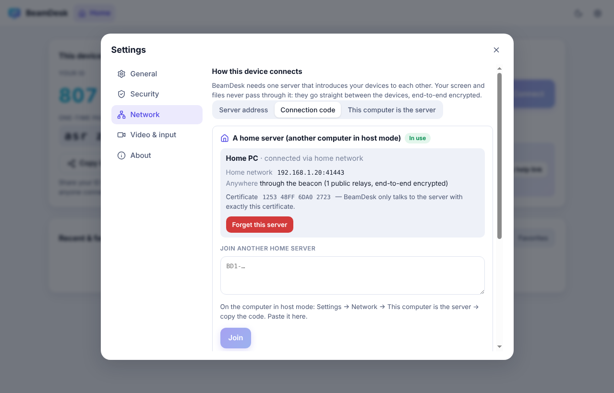

# BeamDesk user guide

This guide is for everyone — no technical knowledge needed.

- [The two halves of the screen](#the-two-halves-of-the-screen)
- [Get help from someone](#get-help-from-someone)
- [Help someone else](#help-someone-else)
- [Help someone who does not have BeamDesk (help link)](#help-someone-who-does-not-have-beamdesk-help-link)
- [During a session](#during-a-session)
- [Reach your own computer any time (unattended access)](#reach-your-own-computer-any-time-unattended-access)
- [Make one of your computers the server (host mode)](#make-one-of-your-computers-the-server-host-mode)
- [Using BeamDesk on a phone or tablet](#using-beamdesk-on-a-phone-or-tablet)
- [Staying safe](#staying-safe)
- [Troubleshooting](#troubleshooting)

---

## Installing

| Your computer | Download | Then |
|---|---|---|
| **Windows** | `BeamDesk-Setup-…-x64.exe` | Double-click it. BeamDesk installs and opens by itself. |
| | `BeamDesk-…-portable.exe` | Runs without installing — handy for a one-off session. |
| **Mac** | `BeamDesk-…-mac-arm64.dmg` (Apple silicon: M1/M2/M3/M4) or `…-mac-x64.dmg` (Intel) | Open it and drag BeamDesk into Applications. |
| **Linux** | `BeamDesk-…-linux-x86_64.AppImage` or `.deb` | AppImage: right-click → Properties → allow executing, then double-click. |

Downloads are on the [Releases page](https://github.com/Safiullah-Rahu/BeamDesk/releases/latest).
You can also skip installing entirely and use BeamDesk **in your web browser** at your BeamDesk server's address.

> **"Windows protected your PC" / "can't be opened because it is from an unidentified developer"?**
> This appears for free apps that are not code-signed. On Windows click **More info → Run anyway**.
> On a Mac, right-click BeamDesk in Applications → **Open** → **Open**. You only need to do this once.

**On a Mac**, BeamDesk will ask for two permissions the first time. Both are needed for someone to help you:

1. **Screen Recording** — so the other person can see your screen.
2. **Accessibility** — so they can move your mouse and type.

BeamDesk shows a yellow banner with an **Open Settings** button for each. Switch BeamDesk **on** in the list that opens, then restart BeamDesk.

---

## The two halves of the screen

<picture>
  <source media="(prefers-color-scheme: dark)" srcset="images/home-dark.png" />
  
</picture>

- **Left — This device.** Your **ID** (9 digits) and, on the desktop app, a **one-time password**. Give these to someone you trust so they can connect to *you*.
- **Right — Connect to another device.** Type someone else's ID here to connect to *them*.
- **Below — Recent & favorites.** Devices you connected to before, one click away. A green dot means the device is online right now.

The pill in the corner tells you whether BeamDesk is **Ready**. If it says *Offline*, check your internet connection.

---

## Get help from someone

1. Open BeamDesk.
2. Tell your helper the **ID** shown under *This device* (for example over the phone: "four eight two, nine one three, zero seven seven").
3. A window appears: **"… wants to connect"**. Check that it is the person you expect, then click **Accept**.
   - Untick *Control mouse & keyboard* if you only want them to watch.
4. A red bar at the top of your screen shows that someone is connected. Click **Disconnect** on it at any time.

<picture>
  <source media="(prefers-color-scheme: dark)" srcset="images/incoming-request-dark.png" />
  
</picture>

**Even faster:** click **Copy invite link** and send it by WhatsApp, e-mail or SMS. Your helper opens it, clicks **Connect**, and is in — the link contains your one-time password (which works once) and your device's security key, so it can only reach *your* computer.

**Prefer not to click Accept?** Read out the **one-time password** too. When your helper enters it, they connect without the prompt. Each password works **once**: as soon as it has let someone in, a new one is made (and it stays hidden while someone is connected).

---

## Help someone else

1. Ask them for their **ID** (and the one-time password, if they want to skip the Accept step).
2. Type the ID under **Connect to another device** and click **Connect**.
   - Have a password? Click **I have a password** first. Tick *Remember on this device* for computers you connect to often.
3. Wait for them to click **Accept**. Their screen appears in a new tab.

Each connection opens in its own tab at the top, so you can help several people at once.

---

## Help someone who does not have BeamDesk (help link)

Perfect for parents, grandparents or customers who should not have to install anything.

1. On your BeamDesk, click **Copy help link** (right side, blue box).
2. Send the link to the person.
3. They open it in Chrome, Edge, Firefox or Safari and click **Share my screen**, then choose the screen to share.
4. You get a notification **"… is sharing their screen with you"** — click **Join now**.

<picture>
  <source media="(prefers-color-scheme: dark)" srcset="images/help-link-dark.png" />
  
</picture>

> In a browser, the person's screen can be **seen** but not controlled — browsers do not allow remote mouse/keyboard control.
> Guide them with chat, or ask them to install the desktop app for full control.

---

## During a session

<picture>
  <source media="(prefers-color-scheme: dark)" srcset="images/remote-session-dark.png" />
  
</picture>

The toolbar at the top of a session (hover over a button to see its name):

| Button | What it does |
|---|---|
| 🖥️ Display | Switch between the other computer's monitors |
| ⏱️ Quality | **Fastest** for slow internet, **Balanced** (recommended), **Best quality** for sharp text. Also *Fit to window* / *Original size* / *Stretch*, and remote sound |
| ⌨️ Keyboard | Send keys your computer would keep for itself: Windows key, Alt+Tab, Win+L (lock), Ctrl+Shift+Esc (Task Manager), Cmd+Space… Switch between *Type text* (works with any keyboard language) and *Physical keys* (for games). On phones: *On-screen keyboard* |
| 📋 Clipboard | Copy on one computer, paste on the other (on by default) |
| ⬆️ Send files | Pick files to send — or simply **drag files onto the remote screen** |
| 💬 Chat | Send messages; a red badge shows unread ones |
| 📷 Screenshot | Save a picture of the remote screen |
| ⏺️ Record | Record the session as a video file |
| 🖱️ View only | Watch without accidentally clicking |
| 📈 Details | Connection quality: *Direct* (fastest) or *Relay*, latency, frame rate, encryption and the security code |
| ⛶ Fullscreen | Full screen (system shortcuts like Alt+Tab go to the remote computer; hold **Esc** to leave) |
| ✕ | Disconnect |

**If you are the one being helped**, the *Someone is connected* card on your home screen lets you switch off **Control**, **Clipboard**, **Files** or **Sound** at any time, chat, send files, or **End** the session.

Files you receive are saved in **Downloads/BeamDesk** (change this in Settings → General). BeamDesk asks before saving a file the other side sends you — always when you are the helper, and for programs, scripts and installers when you are being helped. Only click **Save file** if you expected it.

<picture>
  <source media="(prefers-color-scheme: dark)" srcset="images/file-consent-dark.png" />
  
</picture>

---

## Reach your own computer any time (unattended access)

For your own office or home PC, when nobody is sitting in front of it:

1. On that computer: **Settings → Security → Unattended access**.
2. Choose a **permanent password** (at least 8 characters — longer is better) and click **Set password**. Unattended access switches on.
3. Make sure **Start BeamDesk when I sign in** (Settings → General) is on.
4. From anywhere: enter the computer's ID and the permanent password. You connect without anyone clicking Accept.

Recommended extras: **Lock this computer when a session ends** (Settings → Security), and mark your own devices as trusted.

<picture>
  <source media="(prefers-color-scheme: dark)" srcset="images/settings-security-dark.png" />
  
</picture>

---

## Make one of your computers the server (host mode)

BeamDesk needs a server that introduces your devices to each other. Instead of renting one, a computer
that stays switched on at home (or in the office) can be that server — on any internet connection,
including the ones where nothing can connect to your computer from outside (*carrier-grade NAT*, common
with mobile, fibre and many cable providers).

<picture>
  <source media="(prefers-color-scheme: dark)" srcset="images/settings-hostmode-dark.png" />
  
</picture>

**On the computer that stays on**

1. Open **Settings → Network** and choose **This computer is the server**.
2. Turn on **Host mode**. After a few seconds BeamDesk shows a **connection code** (it starts with `BD2-`).
3. Click the copy button next to the code and send it to yourself (e-mail, chat, a USB stick…).
   **Keep it private:** the code is the key to your server.

BeamDesk also shows where the server can be reached:

- **Home network** — devices on the same Wi‑Fi can always connect.
- **Tailscale** — appears when Tailscale is installed (optional, see below).
- **Direct from the internet** — BeamDesk asks your router to open the port, the way games and video calls do (UPnP / NAT-PMP).
  This is a bonus, not a requirement: it often does not work (a router without UPnP, or *carrier-grade NAT*, where your provider shares one address between many homes). BeamDesk tells you when that is the case.
- **Anywhere, through the beacon** — always on, works everywhere. Your computer keeps a connection to a few free public [Nostr](https://nostr.com) relays (open message servers that anyone can use, no account), and your devices meet it there. Everything is end-to-end encrypted: the relays carry scrambled data between random one-time keys and cannot read, change or fake anything. Once two devices have found each other, the screen goes **directly** between them, as always.

**On your other computers**

1. Install BeamDesk, open **Settings → Network** and choose **Connection code**.
2. Paste the code and click **Join**. The pill turns to **Ready**.
3. Connect with the usual ID and password. Each device takes the fastest way available: home network, Tailscale, the internet address, or the beacon.

If your internet address changes, nothing needs to be shared again: devices that joined learn the new addresses through the beacon.

<picture>
  <source media="(prefers-color-scheme: dark)" srcset="images/settings-joincode-dark.png" />
  
</picture>

**Phones and computers without the app:** copy the **Link for phones and browsers** shown under the code (`https://safiullah-rahu.github.io/BeamDesk/#join=…`) and open it on the phone. Click **Join** — done.
The link opens the browser version of BeamDesk from a public website; the code stays in the part of the link after `#`, which browsers never send anywhere. It works on any network.

The second link, *without the relays*, opens the browser version straight from your computer — handy on the home network. The browser warns that the connection is not private the first time: that is expected for a home server (it has its own certificate instead of one from a company). Choose *Advanced → Continue*, and check that the certificate's fingerprint starts with the characters BeamDesk shows.

**Switching it off and on**

- Turn **Host mode** off in **Settings → Network**, or right-click the BeamDesk icon in the tray / menu bar and untick **Host mode**. The port on the router is closed again.
- Restarting or shutting down the computer is fine: BeamDesk starts when you sign in (*Start with this computer*) and turns the server back on by itself, with the same code.
  Your other devices reconnect on their own.
- *Keep this computer awake while hosting* stops it from going to sleep (the screen can still turn off).
- On Windows, sign in to the computer after a restart (or set Windows to sign in automatically) — BeamDesk starts with your account.

**If something goes wrong**

- *Port … is already used by another program* — choose another port in **Advanced**. The connection code changes; share it again.
- *Through the beacon: connecting to the public relays…* for a long time — your network blocks them (some offices and schools do). Enter other relays under **Advanced → Beacon relays** (any Nostr relay works, also one you run yourself), or use Tailscale.
- A device cannot connect even though both show **Ready**: very strict networks on *both* sides can block the direct screen connection. Tailscale, or a server with a relay (Docker Compose setup), helps there.
- Someone got your code who should not have it? **Advanced → Make a new code.** Every device has to join again with the new code; the old one stops working at once.

### Alternative: Tailscale

The beacon already works without router settings. [Tailscale](https://tailscale.com/download) is an alternative that connects your own devices with each other over the internet, and also relays the screen when both networks are very strict.

1. Install Tailscale on the computer in host mode and on every device you connect from (free for personal use).
2. Sign in to Tailscale with the same account on all of them.
3. Turn on host mode (or click **Check again**): the code now includes the Tailscale address. Join with it on the other devices.

Tailscale is a separate service: it knows which of your devices exist. Your BeamDesk sessions stay end-to-end encrypted on top of it.

### Or use a free cloud server (Render)

If no computer can stay on, a small free server on [Render](https://render.com) can introduce your devices instead:

1. Create a free account on render.com, then open [Deploy BeamDesk to Render](https://render.com/deploy?repo=https://github.com/Safiullah-Rahu/BeamDesk).
2. When Render asks for `ACCESS_KEY`, enter a long password of your choice. Leave the `TURN_…` fields empty and click **Deploy**.
3. Wait until it shows **Live** (about 5 minutes) and copy the address (`https://beamdesk-xxxx.onrender.com`).
4. On every device: **Settings → Network → Server address**, paste the address, enter the access key, **Use this server**. Browsers simply open the address.

The free plan sleeps after 15 minutes without use (the first connection then takes about a minute) and has no relay for very strict networks.

---

## Using BeamDesk on a phone or tablet

Open your BeamDesk server's address in the phone's browser and connect as usual. For a computer in host mode, open its **link for phones** (see above).

<picture>
  <source media="(prefers-color-scheme: dark)" srcset="images/mobile-dark.png" />
  
</picture>

| Gesture | Does |
|---|---|
| Tap | Click |
| Long press | Right-click |
| Drag | Click and drag (move windows, select text) |
| Two-finger drag | Scroll |
| ⌨️ → On-screen keyboard | Type |

---

## Staying safe

- **Only accept people you know.** Scammers sometimes call pretending to be from your bank, Microsoft or "technical support" and ask you to install a remote-desktop app. Hang up.
- **Check the security code.** The accept window and the helper's screen both show the same 8-digit code. Reading it to each other proves nobody is listening in between.
- **You are always in control.** End a session with the red bar's **Disconnect** button, the **End** button on the home screen, or by closing BeamDesk.
- **Permissions per session.** Untick *Control*, *Clipboard* or *Files* in the accept window if the helper only needs to look.
- **Block pests.** *Block this device* in the accept window stops that ID from asking again (undo in Settings → Security).
- **Files are never saved without asking.** A warning appears for files that can run programs (`.exe`, `.msi`, `.dmg`, scripts…). Never open one you did not ask for.
- **Messages from the other device are labelled** "‹name› says: …". BeamDesk itself never asks you to call a phone number or pay anyone.
- **Lock it down.** Settings → Security → *Who can connect*: **Password only** or **Nobody**.

---

## Troubleshooting

| Problem | Try this |
|---|---|
| "That device is offline or the ID is wrong" | Check the 9 digits. BeamDesk must be open (or in the tray) on the other computer and show **Ready**. |
| The pill says *Offline* or *Server error* | Check your internet. On private servers, check the address and access key in **Settings → Network**. |
| Joined a home server, but the pill stays on *Connecting…* | The computer in host mode must be on and show *Ready · hosting*, with *Anywhere, through the beacon: ready*. Through the beacon connecting takes a few seconds. If its code was renewed, join again with the new code. Check that the clock of both devices is right (it is part of the encryption). |
| "Your server is off" | Host mode could not start on this computer — **Details** shows why (usually the port is taken: choose another one in **Advanced**). |
| "Open in another window" | BeamDesk is open in another browser tab. Click **Use here**, or close the other tab. |
| I see the screen but cannot click | The other side shares from a **browser** (view-only), or they switched off *Control*. Also check the **View only** button isn't on. |
| Mac: the screen is black or I cannot control it | Grant **Screen Recording** and **Accessibility** to BeamDesk (System Settings → Privacy & Security), then restart BeamDesk. |
| Linux: I can't control the computer | Remote control needs an **X11** session. On Ubuntu choose *Ubuntu on Xorg* on the login screen (gear icon). |
| It feels slow | Choose **Quality → Fastest**. The details panel (📈) shows *Relay* when a direct connection was impossible — that is slower but still works. |
| The text is blurry | Choose **Quality → Best quality**, or *Original size*. |
| A key combination does not work | Use the **⌨️ Keyboard** menu (Alt+Tab, Win key…), or fullscreen mode. Windows never accepts a remote Ctrl+Alt+Del; use *Ctrl+Shift+Esc* for Task Manager. |
| Copy & paste doesn't work | Check the 📋 button is on and that the other side allows *Clipboard*. In a browser, allow clipboard access when asked. |
| "The other device's security key has changed" | Normal after the other person reinstalled BeamDesk. If you did not expect it, call them before clicking **Trust new identity**. |

Still stuck? [Open an issue](https://github.com/Safiullah-Rahu/BeamDesk/issues) and describe what you see (remove any private details).
